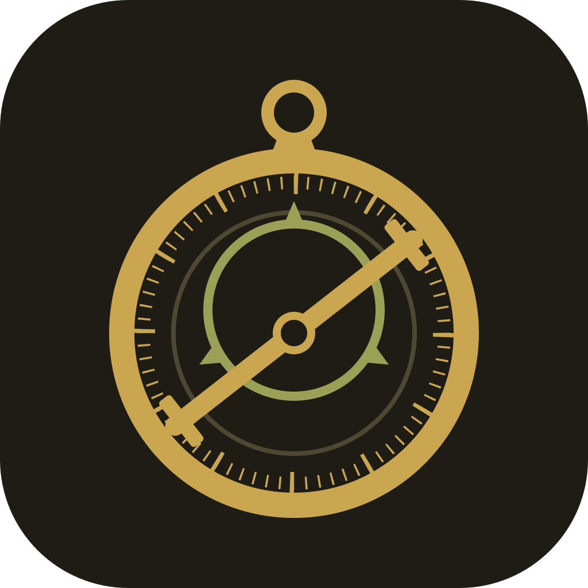

<p align="center">
  
</p>

# Usturlap

İnternet ve baz istasyonu olmadan çalışan, tek elle (eldivenle de) kullanılan kişisel
**taktik harita** uygulaması. Flutter ile yazıldı; önce iOS (iPhone), Android'e hazır.
Hesap yok, reklam yok; uygulama kendi adına veri toplamaz, bütün veri cihazda kalır
(harita karoları Mapbox'tan gelir, bkz. [gizlilik](website/gizlilik.html)).

> Proje önce **Pusula**, sonra **Kerteriz** adını taşıdı. Eski dosyalar açılmaya devam
> etsin diye bazı görünmez biçim kimlikleri eski adla kalır (KML/GeoJSON `kerteriz`
> verisi, CoT `__kerteriz` / `__pusula` öğeleri, `.krz` yedek biçimi).

## Özellikler

- **Harita:** Mapbox Uydu / Sokak / Topografik, OpenStreetMap, OpenTopoMap. Çevrimdışı
  kullanım için bölge indirme (harita türü seçerek) ve kendi **MBTiles / PMTiles /
  GeoPackage** katmanlarınız. Kaydedilmiş görünümler, gece modu, yatay ekran.
- **Konum ve navigasyon:** MGRS / UTM / WGS84 / DM / DMS; coğrafi, manyetik (WMM2025)
  ya da grid kuzeyi; derece ya da mil. "Git" (düz hatta kerteriz + mesafe), rotalar ve
  rota takibi, taktik pusula, canlı takip, geriden kestirme, elle konum girme.
- **Ölçüm ve arazi:** mesafe-kerteriz çizgisi, menzil halkaları, bullseye; yükseklik
  verisiyle (HGT) yükseklik profili, görüş alanı, eş yükselti ve eğim.
- **İşaretleme ve çizim:** askerî semboller (APP-6), görev noktaları, görüş konisi;
  alan, çizgi, daire, dikdörtgen, serbest çizim, 3B kutu; şekil düzenleme, lasso seçimi,
  geofence (sesli uyarı ve arka plan bildirimi), noktalara fotoğraf ve galeri.
- **Veri ve paylaşım:** KML / KMZ / GPX / GeoJSON içe ve dışa aktarma, TAK uyumlu CoT
  veri paketi, AirDrop ya da Dosyalar'dan "Usturlap ile aç".
- **Saha:** iz kaydı (ekran kapalıyken de), raporlar (9 satır vb.), güneş ve ay,
  hava durumu (Open-Meteo, isteğe bağlı), pil alarmı, ekranı açık tutma.
- **Gizlilik ve güvenlik:** parolayla şifreli yedek (PBKDF2 + AES-GCM), içeriği hızlı
  silme.

## Yol haritası

**Faz 2: Mesh (Meshtastic).** İnternetsiz ekip ağı: BLE ile Meshtastic düğümüne
bağlanma, ekip konumlarını haritada görme, mesh üzerinden kısa mesaj ve nokta / veri
paketi paylaşma. Mimari buna hazır (`PositionSource` / `CommsChannel` arayüzleri); bkz.
[`docs/faz2-brief.md`](docs/faz2-brief.md).

## Tanıtım sitesi

`website/` (statik, derleme yok) → https://aoyilmaz.github.io/usturlap/ (GitHub Actions,
`.github/workflows/pages.yml`). Ekran görüntüleri ve videolar simülatörde demo verisiyle
üretilir: `python3 tool/capture_site_media.py` (`integration_test/showcase_test.dart`).
Yerelde bakmak için: `python3 -m http.server -d website`.

## Mimari

`presentation (features/) → domain (models, ports, usecases) → data (db, tiles,
position, …)`, Riverpod ile. Domain saf Dart; veritabanı `drift` (SQLite).

## Çalıştırma

```bash
flutter pub get
flutter run --dart-define-from-file=dart_defines.json   # bağlı iOS/Android cihaz
```

`dart_defines.json` repoda yoktur; içine kendi Mapbox anahtarınızı koyun:
`{"MAPBOX_ACCESS_TOKEN": "pk..."}`. iOS'ta cihaza kurmak için Xcode imzalaması gerekir
(`ios/Runner.xcworkspace`). Geliştirme: `flutter analyze` · `flutter test`.

Çevrimdışı karo dosyaları (`.mbtiles` / `.pmtiles`) büyük olduğu için repoda değildir;
uygulama içinden içe aktarılır ya da `assets/tiles/` altına konur.

Uygulama ikonu `assets/icon/usturlap_icon.svg` kaynağından üretilir:
`python3 tool/render_icons.py` (Chrome + Pillow).

## Lisans

Kişisel proje; şu an bir lisans verilmemiştir.
